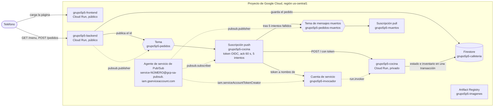
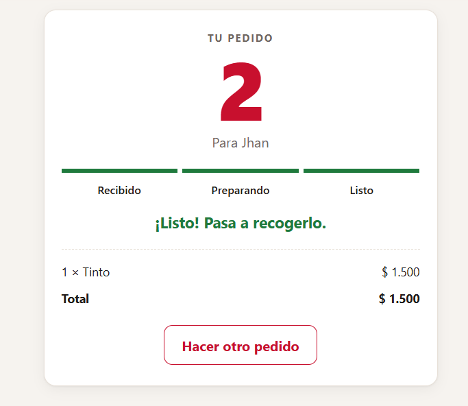

# Cafetería asíncrona

Una cafetería universitaria donde pides desde el teléfono y la respuesta llega de inmediato: "pedido recibido, número 11". Desde ahí la cocina trabaja por su cuenta y el pedido avanza solo por `recibido`, `preparando` y `listo`. Nadie se queda mirando la pantalla mientras le preparan el café; la página consulta el estado cada pocos segundos y te avisa cuando puedes ir a recogerlo.

Para lograrlo, el backend no le pide nada a la cocina directamente. Guarda el pedido en Firestore, deja un mensaje en un tema de Pub/Sub y responde. Pub/Sub le entrega ese mensaje a la cocina, un servicio privado en Cloud Run que nadie más puede llamar. La plantilla trae las tres aplicaciones completas y la infraestructura del frontend y el backend; tu grupo construye en Terraform todo lo que conecta al backend con la cocina.

| Pedir | Seguir el pedido | Pantalla de la cafetería |
|---|---|---|
|  |  |  |

Si el frontend no logra hablar con el backend, lo dice en vez de quedarse en blanco:


## Arquitectura al terminar la práctica


Las flechas punteadas son los permisos de IAM que da tu grupo. La etiqueta es el rol sin el prefijo `roles/` y la flecha llega al recurso sobre el que se da: el backend puede publicar solo en ese tema, el agente de Pub/Sub puede firmar tokens como la cuenta invocadora y esa cuenta puede invocar solo a la cocina.

En la plantilla, el backend ya sabe publicar, pero la variable `TEMA` está vacía: guarda el pedido, registra una advertencia y no avisa a nadie. Por eso, recién desplegada, la cafetería recibe pedidos que se quedan en `recibido` para siempre.

## Estructura del repositorio

```
backend/main.py            API en Flask: menú, pedidos, inventario y publicación en Pub/Sub
backend/requirements.txt   Dependencias del backend con versión fija
backend/Dockerfile         Imagen del backend con gunicorn
cocina/main.py             Worker que recibe las entregas push y prepara los pedidos
cocina/requirements.txt    Dependencias de la cocina con versión fija
cocina/Dockerfile          Imagen de la cocina con gunicorn
frontend/index.html        La página: vista para pedir y pantalla de la cafetería
frontend/server.py         Servidor sin dependencias que inyecta BACKEND_URL en la página
frontend/Dockerfile        Imagen del frontend
infra/providers.tf         Versión de Terraform y del proveedor de Google
infra/variables.tf         Proyecto, prefijo, región e imágenes
infra/main.tf              APIs, registro, Firestore, backend y frontend con sus cuentas
infra/outputs.tf           Ruta del registro y URL de los servicios
infra/terraform.tfvars.example   Ejemplo de valores; cópialo como terraform.tfvars
docs/api.md                Endpoints del backend y formato del mensaje de Pub/Sub
docs/estados.md            Ciclo de vida de un pedido y quién hace cada cambio
docs/capturas/             Capturas de la aplicación usadas en este README
.gitignore                 Deja por fuera el estado de Terraform, tus tfvars y __pycache__
```

## Cómo empezar

### Flujo de trabajo

1. Crea el repositorio de tu grupo con **Use this template** en GitHub.
2. Edita en VS Code o en github.dev (tecla `.` en la página del repositorio).
3. Haz commit y push desde el editor.
4. En Cloud Shell clonas la primera vez y traes los cambios con `git pull` después. Desde Cloud Shell nunca haces push.
5. Docker y Terraform se ejecutan siempre en Cloud Shell. La consola de Google Cloud es para mirar y diagnosticar, no para crear recursos.

### Primer despliegue

En Cloud Shell:

```bash
git clone https://github.com/<tu-usuario>/<tu-repositorio>.git
cd <tu-repositorio>/infra
cp terraform.tfvars.example terraform.tfvars
cloudshell edit terraform.tfvars
```

En `terraform.tfvars` pon el ID de tu proyecto y el prefijo del grupo, y ajusta las rutas de las imágenes a esos mismos valores. Este archivo vive solo en Cloud Shell: el `.gitignore` evita que llegue a GitHub.

El orden importa, porque las imágenes necesitan el registro y los servicios necesitan las imágenes:

```bash
# 1. Solo el registro (y las APIs de las que depende)
terraform init
terraform apply -target=google_artifact_registry_repository.registro

# 2. Las imágenes
REGISTRO=$(terraform output -raw registro)
gcloud auth configure-docker us-central1-docker.pkg.dev --quiet
cd ..
docker build -t $REGISTRO/backend:v1 backend
docker push $REGISTRO/backend:v1
docker build -t $REGISTRO/frontend:v1 frontend
docker push $REGISTRO/frontend:v1

# 3. Todo lo demás
cd infra
terraform apply
terraform output
```

Abre `url_frontend` en el teléfono. Si usas otra región, cambia `us-central1` en el comando de `gcloud auth configure-docker`.

Cuando cambies el código de un servicio, construye y sube la imagen con una etiqueta nueva (`v2`, `v3`...), actualízala en `terraform.tfvars` y vuelve a aplicar. Si subes otra vez la misma etiqueta, Terraform no ve ningún cambio y Cloud Run sigue con la versión anterior.

## Probar cada servicio con `docker run`

Antes de subir una imagen, pruébala en Cloud Shell. Para ver una página servida en Cloud Shell usa **Vista previa en la Web** y elige el puerto.

**Frontend.** No necesita credenciales:

```bash
docker run --rm -p 8080:8080 -e BACKEND_URL=https://<url-del-backend> $REGISTRO/frontend:v1
```

Abre la vista previa en el puerto 8080. Si no pasas `BACKEND_URL`, verás el mensaje de error de la captura de arriba.

**Backend sin Firestore.** El contenedor arranca aunque no tenga credenciales; la validación de pedidos no toca la base, así que puedes comprobarla:

```bash
docker run --rm -d --name backend -p 8081:8080 $REGISTRO/backend:v1
curl -i -X POST localhost:8081/pedidos -H 'Content-Type: application/json' -d '{"cliente": "Ana", "items": []}'
docker logs backend
docker rm -f backend
```

Debe responder `400` con el error en JSON.

**Backend con Firestore.** Cuando la base ya existe (después del primer `terraform apply` completo), puedes darle al contenedor tus propias credenciales:

```bash
gcloud auth application-default login
docker run --rm -d --name backend -p 8081:8080 \
  -e GOOGLE_CLOUD_PROJECT=<tu-proyecto> \
  -e BASE_DATOS=<prefijo>-cafeteria \
  -e GOOGLE_APPLICATION_CREDENTIALS=/adc.json \
  -v $HOME/.config/gcloud/application_default_credentials.json:/adc.json:ro \
  $REGISTRO/backend:v1
curl localhost:8081/menu
curl -X POST localhost:8081/pedidos -H 'Content-Type: application/json' \
  -d '{"cliente": "Ana", "items": [{"producto": "tinto", "cantidad": 1}]}'
```

**Cocina.** Escucha en `/` el mismo sobre que le entregaría Pub/Sub. Con las mismas credenciales, puedes hacerte pasar por Pub/Sub y entregarle a mano un pedido que esté en `recibido`:

```bash
docker build -t cocina cocina
docker run --rm -d --name cocina -p 8082:8080 \
  -e GOOGLE_CLOUD_PROJECT=<tu-proyecto> \
  -e BASE_DATOS=<prefijo>-cafeteria \
  -e GOOGLE_APPLICATION_CREDENTIALS=/adc.json \
  -v $HOME/.config/gcloud/application_default_credentials.json:/adc.json:ro \
  cocina
ID=<id de un pedido en recibido>
curl -i -X POST localhost:8082/ -H 'Content-Type: application/json' \
  -d "{\"message\": {\"data\": \"$(printf %s "$ID" | base64)\"}, \"deliveryAttempt\": 1}"
docker logs cocina
```

Responde `204` cuando termina, unos segundos después. Mira el pedido en la pantalla de la cafetería: acabas de hacer a mano lo que Pub/Sub va a hacer solo.

La cocina tiene dos variables para provocar fallas: `TIEMPO_PREPARACION` (segundos que tarda, 6 por defecto) y `PROBABILIDAD_FALLO` (entre 0 y 1; con esa probabilidad responde `500` después de haber terminado el trabajo). Los detalles están en [docs/api.md](docs/api.md) y el recorrido de un pedido en [docs/estados.md](docs/estados.md).

El plato misterioso falla siempre, y sin un tema de mensajes muertos Pub/Sub lo sigue reintentando mientras retenga el mensaje, que por defecto son 7 días. Cada intento deja un error en los logs de la cocina, así que se van a llenar hasta que tu grupo resuelva esa parte del reto.

---

# Informe del grupo

## Integrantes

| Nombre | Código | Usuario de GitHub |
|---|---|---|
| Angely Sofia Pino | 1152315 | [AngelyDema](https://github.com/AngelyDema) |
| Jhan Ávila Torres | 1152490 | [JhanFranco1152490](https://github.com/JhanFranco1152490) |

## URL de la cafetería

Frontend: https://grupo5p5-frontend-ank53khbyq-uc.a.run.app

## Diagrama propio



Las flechas punteadas son los permisos de IAM, con el rol sin el prefijo `roles/` y apuntando al recurso sobre el que se da. Las fases 2 y 3 dan `pubsub.publisher` al backend sobre el tema, `iam.serviceAccountTokenCreator` al agente de Pub/Sub sobre la cuenta invocadora y `run.invoker` a esa cuenta sobre la cocina. El reto agrega dos permisos al agente de Pub/Sub: `pubsub.publisher` sobre el tema de muertos y `pubsub.subscriber` sobre la suscripción de la cocina. Además, las cuentas del backend y de la cocina tienen `roles/datastore.user` sobre el proyecto para usar Firestore.

## Evidencias por fase

### Evidencia 0


```
angelysofiapg@cloudshell:~/practica5-cafeteria-asincrono-g5 (nube-practica-1-507220)$ gcloud config list
[accessibility]
screen_reader = True
[component_manager]
disable_update_check = True
[compute]
gce_metadata_read_timeout_sec = 30
[core]
account = angelysofiapg@ufps.edu.co
disable_usage_reporting = False
project = nube-practica-1-507220
universe_domain = googleapis.com
[metrics]
environment = devshell

Your active configuration is: [cloudshell-5044]
[environment: untagged] Read more to tag: g.co/cloud/project-env-tag.
```
### Evidencia 1:
Imagenes creadas:
```
angelysofiapg@cloudshell:~/practica5-cafeteria-asincrono-g5/infra (nube-practica-1-507220)$ gcloud artifacts docker images list us-central1-docker.pkg.dev/nube-practica-1-507220/grupo5p5-imagenes
Listing items under project nube-practica-1-507220, location us-central1, repository grupo5p5-imagenes.

IMAGE: us-central1-docker.pkg.dev/nube-practica-1-507220/grupo5p5-imagenes/backend
DIGEST: sha256:057c1aa4038d432f6dfd0108d2b9dc991b39607cdd2a2326275b154dd8f61b81
CREATE_TIME: 2026-11-07T22:55:22
UPDATE_TIME: 2026-11-07T22:55:22
SIZE: 70507436

IMAGE: us-central1-docker.pkg.dev/nube-practica-1-507220/grupo5p5-imagenes/backend
DIGEST: sha256:47822e2c301ebc0ad695be71852ecb99db0cca39f758ac663947e19b5459db2c
CREATE_TIME: 2026-11-07T22:55:22
UPDATE_TIME: 2026-11-07T22:55:22
SIZE: 1664

IMAGE: us-central1-docker.pkg.dev/nube-practica-1-507220/grupo5p5-imagenes/backend
DIGEST: sha256:da45702d4eeda4574f5cec608ec11efb68618d4743c4dc44fa79d23a8917d84e
CREATE_TIME: 2026-11-07T22:55:22
UPDATE_TIME: 2026-11-07T22:55:22
SIZE: None

IMAGE: us-central1-docker.pkg.dev/nube-practica-1-507220/grupo5p5-imagenes/cocina
DIGEST: sha256:5a0afb2188bd8b36ab81e4b24cbd6583a84ed643a7bbdef12b14904a93e9b9c7
CREATE_TIME: 2026-11-07T22:51:48
UPDATE_TIME: 2026-11-07T22:51:48
SIZE: 1658

IMAGE: us-central1-docker.pkg.dev/nube-practica-1-507220/grupo5p5-imagenes/cocina
DIGEST: sha256:5c17d8df4145d67f46cd4f3fbc7d6f1b350c1cd0c3f732f9c1c4b7a2f737b3a3
CREATE_TIME: 2026-11-07T22:51:48
UPDATE_TIME: 2026-11-07T22:51:48
SIZE: 69118238

IMAGE: us-central1-docker.pkg.dev/nube-practica-1-507220/grupo5p5-imagenes/cocina
DIGEST: sha256:b81998cbf4728d22df7cae4715a04cc23b3acfb409d995cfa59ed7c19a86c0b8
CREATE_TIME: 2026-11-07T22:51:48
UPDATE_TIME: 2026-11-07T22:51:48
SIZE: None

IMAGE: us-central1-docker.pkg.dev/nube-practica-1-507220/grupo5p5-imagenes/frontend
DIGEST: sha256:406d88af4c26957484a0a1d038cd71475faafbae351d18dfb9cf641857e3f73c
CREATE_TIME: 2026-11-07T23:03:09
UPDATE_TIME: 2026-11-07T23:03:09
SIZE: 44314420

IMAGE: us-central1-docker.pkg.dev/nube-practica-1-507220/grupo5p5-imagenes/frontend
DIGEST: sha256:706f1a821f4ad8ac0dfed8c2d4390678d1d8df08f7d0e7bddbf9bf0989cff33f
CREATE_TIME: 2026-11-07T23:03:09
UPDATE_TIME: 2026-11-07T23:03:09
SIZE: 1669

IMAGE: us-central1-docker.pkg.dev/nube-practica-1-507220/grupo5p5-imagenes/frontend
DIGEST: sha256:dc668395cfccc92cd9a22199f5c3107f3132489e9798646c03c6858837886a2d
CREATE_TIME: 2026-11-07T23:03:10
UPDATE_TIME: 2026-11-07T23:03:10
SIZE: None
```
Imagen del frontend en celular:


Advertencia del backend: 


### Evidencia 2: 

Pedido publicado: 


Pedido en recibido: 


Tema: 


### Evidencia 3: 

Pedido procesado en el teléfono: 


Subscripción: 


Salida del curl con el 403: 


### Evidencia 4:

Salida de la rafaga:


Varias casillas: 


Reponer inventario:


Cantidad de instancias (gráfica):


Mensajes:


### Evidencia 5: 

Inventario en la pantalla de la cafetería durante la prueba con `PROBABILIDAD_FALLO` en `0.5`:


Registro de la cocina con la falla simulada (el trabajo quedó hecho pero no se confirmó, así que Pub/Sub vuelve a entregar el pedido):


### Evidencia 6:

**Inventario cuadrando con la falla inyectada.** Con `PROBABILIDAD_FALLO` en `0.5`, se repuso el inventario (20 tintos) y se hicieron cuatro pedidos de un tinto. Se hizo dos veces y las dos veces quedaron 16:

```
$ curl -s $B/menu | python3 -c "... if p['producto']=='tinto'"
[('tinto', 16)]
```

Historia de uno de los pedidos en los registros de la cocina. Llegó dos veces y se descontó una sola:

```
04:48:23.845  INFO:cocina:Pedido 8xFeFrcD2IHKXyOLOtIO, intento de entrega 1
04:48:30.382  INFO:cocina:Pedido 8xFeFrcD2IHKXyOLOtIO listo
04:48:30.382  WARNING:cocina:Falla simulada en el pedido 8xFeFrcD2IHKXyOLOtIO: el trabajo quedó hecho pero no se confirma
04:48:43.045  INFO:cocina:Pedido 8xFeFrcD2IHKXyOLOtIO, intento de entrega 2
04:48:43.148  INFO:cocina:Pedido 8xFeFrcD2IHKXyOLOtIO ya estaba listo; entrega repetida, no se descuenta otra vez
```

Con la cocina de la plantilla, el mismo pedido habría descontado el tinto en las dos entregas.

**Mensaje del plato misterioso leído desde el tema de muertos.** La cocina falló 5 veces seguidas con `La cocina no tiene receta para el plato misterioso` (los intentos llevan número porque la suscripción tiene política de mensajes muertos: `deliveryAttempt` ya no dice "desconocido"). Al quinto, Pub/Sub lo pasó al tema `grupo5p5-pedidos-muertos`, y se leyó con `gcloud pubsub subscriptions pull grupo5p5-muertos --auto-ack --limit=5`:

```
DATA: SD36OaLQXsVSoCzud1YG
MESSAGE_ID: 23319591402322823
ATTRIBUTES: CloudPubSubDeadLetterSourceDeliveryCount=5
CloudPubSubDeadLetterSourceSubscription=grupo5p5-cocina
CloudPubSubDeadLetterSourceSubscriptionProject=cafeteria-g5-jhan-31973
CloudPubSubDeadLetterSourceTopicPublishTime=2026-11-09T04:49:28.456+00:00
ACK_STATUS: SUCCESS
```

Los intentos de ese pedido, con la espera creciendo entre uno y otro:

```
04:49:28  intento de entrega 1
04:49:41  intento de entrega 2
04:49:56  intento de entrega 3
04:50:18  intento de entrega 4
04:50:45  intento de entrega 5
```

**Mediciones.** Operaciones de Firestore de un pedido de un producto que llega bien a la primera, contadas a partir del código (no medidas en la consola):

| Paso | Lecturas | Escrituras |
|---|---|---|
| Backend: número consecutivo y guardar el pedido | 0 | 2 |
| Cocina: pasar a `preparando` | 1 | 1 |
| Cocina: revisar estado y existencias, descontar y dejar `listo` | 2 | 2 |
| **Total (pedido `listo`)** | **3** | **5** |

Un pedido `rechazado` hace 3 lecturas y 4 escrituras. Una entrega repetida de un pedido ya terminado hace 1 lectura y ninguna escritura. Las lecturas de la página (`GET /pedidos`) no están contadas.

**Reproducción desde cero.** Se desplegó todo en un proyecto nuevo (`cafeteria-g5-jhan-31973`) con el repo tal como está: `terraform apply -target` del registro, tres imágenes con `docker build` y `docker push`, y un solo `terraform apply` que creó 21 recursos, sin pasos en la consola. La cocina responde `403` sin token y un pedido hecho desde el teléfono llegó a `listo`:


## Decisiones del reto

**Cómo sabe la cocina que un pedido ya se preparó.** Consulta el campo `estado` del pedido en Firestore: si es `listo` o `rechazado`, la entrega es repetida y responde `204` sin tocar nada. Revisar el estado, revisar las existencias y descontar van en una sola transacción de Firestore (`terminar` en `cocina/main.py`), y la marca de `listo` se escribe dentro de esa misma transacción, así que no hay un momento en que el inventario ya esté descontado y el pedido todavía no lo diga. Si dos entregas del mismo pedido llegan a la vez a dos instancias, Firestore detecta que ambas leyeron el mismo documento: la primera en confirmar gana y la otra repite la transacción con los datos nuevos, ve `listo` y devuelve `repetido`. Ese reintento de transacciones es el mismo que arregla el inventario negativo de la fase 4, y se permiten hasta 10 intentos porque en una ráfaga muchos pedidos pelean por el documento del mismo producto. Además, un primer paso (`empezar`) marca `preparando` también en una transacción y solo si el pedido no está terminado.

**Cuántos intentos antes de rendirse.** 5, que es el mínimo que admite Pub/Sub, con espera creciente de 10 a 60 segundos entre intentos. En los registros las esperas fueron de unos 15, 17, 19 y 26 segundos, así que un pedido se rinde a los 80 segundos de su primera entrega. Un problema pasajero (por ejemplo un permiso que tarda en propagarse o un corte corto de Firestore) se resuelve en alguno de esos reintentos y el cliente solo ve que el pedido tardó un poco más. Una falla que dure más que eso manda el mensaje al tema de muertos, donde se puede leer y volver a publicar a mano, en vez de reintentarse durante 7 días. El costo es que un pedido que ya terminó pero falló 5 veces seguidas en confirmarse también acabaría ahí, aunque su inventario esté bien.

**Los permisos de los mensajes muertos.** `roles/pubsub.publisher` sobre el tema de muertos lo necesita el agente de Pub/Sub porque es él, y no la cocina, quien reenvía el mensaje a ese tema. `roles/pubsub.subscriber` sobre la suscripción de la cocina lo necesita para confirmar (`ack`) el mensaje original después de reenviarlo; sin ese permiso el mensaje seguiría vivo en la suscripción de la cocina y se reintentaría de nuevo. Si faltara la suscripción en el tema de muertos, el mensaje se publicaría en un tema que no guarda nada y se perdería para siempre: justo el caso de la fase 2, donde el tema descartó el pedido por no tener suscripciones. Por eso existe `grupo5p5-muertos`.

**Cómo medimos.** Lo que se midió es el inventario y el número de entregas por pedido, con la propia API y los registros. Después de reponer el inventario con `curl -s -X POST $B/inventario/reiniciar` y hacer cuatro pedidos de un tinto, se leyó el tinto con `curl -s $B/menu`; la prueba se repitió dos veces y las dos dio 16. Las entregas de cada pedido se contaron con `gcloud logging read` sobre el servicio `grupo5p5-cocina`, filtrando por el id del pedido y ordenando por hora. Las lecturas y escrituras de Firestore se contaron en el código y no en la consola. No se midió el tiempo de una ráfaga con distintos máximos de instancias; por diseño lo limitan los 6 segundos de preparación y las 8 peticiones simultáneas por instancia, que con el máximo de 3 instancias dejan 24 pedidos preparándose a la vez.

## Preguntas

**¿Por qué el pedido de la fase 2 nunca se preparó, aunque después crearon la suscripción?** Porque un tema de Pub/Sub no guarda mensajes: cuando alguien publica, el tema entrega una copia a cada suscripción que existe en ese momento, y si no hay ninguna, el mensaje se descarta. Cuando el backend publicó el id de ese pedido, el tema no tenía suscripciones, así que la copia se perdió. La suscripción que se creó después solo recibe los mensajes publicados a partir de su creación; no hay nada que le pida al backend volver a publicar. El pedido quedó en Firestore con estado `recibido` y nadie volvió a avisarle a la cocina.

**Si quitan el `run.invoker` de la cuenta invocadora, ¿qué deja de funcionar, cuánto tarda en notarse, qué ve el cliente en el teléfono y dónde encontrarían el error?** Deja de funcionar la entrega de Pub/Sub a la cocina: la suscripción sigue enviando el `POST` con el token de la cuenta invocadora, pero Cloud Run lo rechaza con `403` antes de que llegue al código de la cocina. El backend sigue publicando y respondiendo `201`, así que el pedido se guarda bien. Se nota desde la primera entrega después de que el cambio de IAM se propaga, que suele tardar un par de minutos; antes de eso las instancias pueden seguir aceptando entregas. El cliente ve el pedido atascado en `recibido` para siempre, sin ningún error en pantalla. El error no aparece en los registros de texto de la cocina, porque la petición nunca llega a ejecutarse; hay que buscarlo en el registro de solicitudes de Cloud Run (`run.googleapis.com/requests`), donde sale el `403`, o en las métricas de la suscripción en Pub/Sub, donde las entregas push fallan. Con la política de mensajes muertos, además, tras 5 entregas rechazadas cada pedido se desvía al tema de muertos, y ahí hay que republicarlo una vez arreglado el permiso. Esta respuesta es razonada a partir de cómo funciona el sistema y del `403` que sale al llamar a la cocina sin token (Evidencia 3); no se probó quitando el permiso.

**Con `PROBABILIDAD_FALLO` en `0.5`, ¿cuántas veces le llega en promedio un mismo pedido a la cocina, con la cocina de la plantilla y con la idempotente?** Con la cocina de la plantilla, cada entrega repite todo el trabajo y vuelve a tirar la moneda: el número de entregas es geométrico, con media 1 / (1 − 0,5) = **2**. Con la idempotente, solo la primera entrega puede fallar después de hacer el trabajo: en la segunda, el pedido ya está en `listo`, la cocina responde `204` en el chequeo de estado y nunca llega a la parte que simula la falla. Así que el pedido llega 1 vez y, con probabilidad 0,5, una segunda: media 1 + 0,5 = **1,5**. Los dos números difieren porque la idempotencia no evita las entregas repetidas (Pub/Sub las sigue mandando mientras no reciba un `2xx`), sino que corta la cadena de fallas y hace que repetirse no cueste nada. Lo medido no alcanza para comparar con estos promedios: seguimos con detalle un pedido que falló (`8xFeFrcD2IHKXyOLOtIO`), que llegó 2 veces y se descontó 1, pero no se contaron las entregas de un número grande de pedidos.
