# Cafetería asíncrona

Una cafetería universitaria donde pides desde el teléfono y la respuesta llega de inmediato: "pedido recibido, número 11". Desde ahí la cocina trabaja por su cuenta y el pedido avanza solo por `recibido`, `preparando` y `listo`. Nadie se queda mirando la pantalla mientras le preparan el café; la página consulta el estado cada pocos segundos y te avisa cuando puedes ir a recogerlo.

Para lograrlo, el backend no le pide nada a la cocina directamente. Guarda el pedido en Firestore, deja un mensaje en un tema de Pub/Sub y responde. Pub/Sub le entrega ese mensaje a la cocina, un servicio privado en Cloud Run que nadie más puede llamar. La plantilla trae las tres aplicaciones completas y la infraestructura del frontend y el backend; tu grupo construye en Terraform todo lo que conecta al backend con la cocina.

| Pedir | Seguir el pedido | Pantalla de la cafetería |
|---|---|---|
|  |  |  |

Si el frontend no logra hablar con el backend, lo dice en vez de quedarse en blanco:


## Arquitectura al terminar la práctica

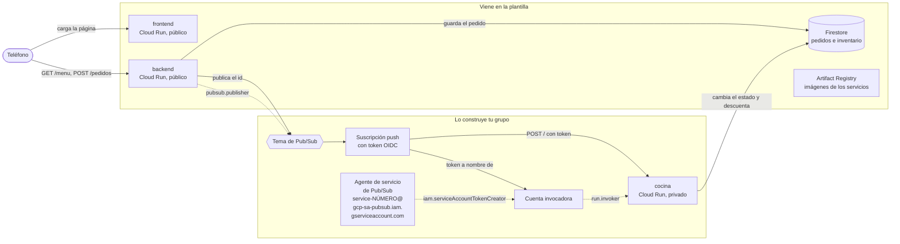

Las flechas punteadas son los permisos de IAM que da tu grupo. La etiqueta es el rol sin el prefijo `roles/` y la flecha llega al recurso sobre el que se da: el backend puede publicar solo en ese tema, el agente de Pub/Sub puede firmar tokens como la cuenta invocadora y esa cuenta puede invocar solo a la cocina.

En la plantilla, el backend ya sabe publicar, pero la variable `TEMA` está vacía: guarda el pedido, registra una advertencia y no avisa a nadie. Por eso, recién desplegada, la cafetería recibe pedidos que se quedan en `recibido` para siempre.

## Estructura del repositorio

```
backend/main.py            API en Flask: menú, pedidos, inventario y publicación en Pub/Sub
backend/requirements.txt   Dependencias del backend con versión fija
backend/Dockerfile         Imagen del backend con gunicorn
cocina/main.py             Worker que recibe las entregas push y prepara los pedidos
cocina/requirements.txt    Dependencias de la cocina con versión fija
cocina/Dockerfile          Imagen de la cocina con gunicorn
frontend/index.html        La página: vista para pedir y pantalla de la cafetería
frontend/server.py         Servidor sin dependencias que inyecta BACKEND_URL en la página
frontend/Dockerfile        Imagen del frontend
infra/providers.tf         Versión de Terraform y del proveedor de Google
infra/variables.tf         Proyecto, prefijo, región e imágenes
infra/main.tf              APIs, registro, Firestore, backend y frontend con sus cuentas
infra/outputs.tf           Ruta del registro y URL de los servicios
infra/terraform.tfvars.example   Ejemplo de valores; cópialo como terraform.tfvars
docs/api.md                Endpoints del backend y formato del mensaje de Pub/Sub
docs/estados.md            Ciclo de vida de un pedido y quién hace cada cambio
docs/capturas/             Capturas de la aplicación usadas en este README
.gitignore                 Deja por fuera el estado de Terraform, tus tfvars y __pycache__
```

## Cómo empezar

### Flujo de trabajo

1. Crea el repositorio de tu grupo con **Use this template** en GitHub.
2. Edita en VS Code o en github.dev (tecla `.` en la página del repositorio).
3. Haz commit y push desde el editor.
4. En Cloud Shell clonas la primera vez y traes los cambios con `git pull` después. Desde Cloud Shell nunca haces push.
5. Docker y Terraform se ejecutan siempre en Cloud Shell. La consola de Google Cloud es para mirar y diagnosticar, no para crear recursos.

### Primer despliegue

En Cloud Shell:

```bash
git clone https://github.com/<tu-usuario>/<tu-repositorio>.git
cd <tu-repositorio>/infra
cp terraform.tfvars.example terraform.tfvars
cloudshell edit terraform.tfvars
```

En `terraform.tfvars` pon el ID de tu proyecto y el prefijo del grupo, y ajusta las rutas de las imágenes a esos mismos valores. Este archivo vive solo en Cloud Shell: el `.gitignore` evita que llegue a GitHub.

El orden importa, porque las imágenes necesitan el registro y los servicios necesitan las imágenes:

```bash
# 1. Solo el registro (y las APIs de las que depende)
terraform init
terraform apply -target=google_artifact_registry_repository.registro

# 2. Las imágenes
REGISTRO=$(terraform output -raw registro)
gcloud auth configure-docker us-central1-docker.pkg.dev --quiet
cd ..
docker build -t $REGISTRO/backend:v1 backend
docker push $REGISTRO/backend:v1
docker build -t $REGISTRO/frontend:v1 frontend
docker push $REGISTRO/frontend:v1

# 3. Todo lo demás
cd infra
terraform apply
terraform output
```

Abre `url_frontend` en el teléfono. Si usas otra región, cambia `us-central1` en el comando de `gcloud auth configure-docker`.

Cuando cambies el código de un servicio, construye y sube la imagen con una etiqueta nueva (`v2`, `v3`...), actualízala en `terraform.tfvars` y vuelve a aplicar. Si subes otra vez la misma etiqueta, Terraform no ve ningún cambio y Cloud Run sigue con la versión anterior.

## Probar cada servicio con `docker run`

Antes de subir una imagen, pruébala en Cloud Shell. Para ver una página servida en Cloud Shell usa **Vista previa en la Web** y elige el puerto.

**Frontend.** No necesita credenciales:

```bash
docker run --rm -p 8080:8080 -e BACKEND_URL=https://<url-del-backend> $REGISTRO/frontend:v1
```

Abre la vista previa en el puerto 8080. Si no pasas `BACKEND_URL`, verás el mensaje de error de la captura de arriba.

**Backend sin Firestore.** El contenedor arranca aunque no tenga credenciales; la validación de pedidos no toca la base, así que puedes comprobarla:

```bash
docker run --rm -d --name backend -p 8081:8080 $REGISTRO/backend:v1
curl -i -X POST localhost:8081/pedidos -H 'Content-Type: application/json' -d '{"cliente": "Ana", "items": []}'
docker logs backend
docker rm -f backend
```

Debe responder `400` con el error en JSON.

**Backend con Firestore.** Cuando la base ya existe (después del primer `terraform apply` completo), puedes darle al contenedor tus propias credenciales:

```bash
gcloud auth application-default login
docker run --rm -d --name backend -p 8081:8080 \
  -e GOOGLE_CLOUD_PROJECT=<tu-proyecto> \
  -e BASE_DATOS=<prefijo>-cafeteria \
  -e GOOGLE_APPLICATION_CREDENTIALS=/adc.json \
  -v $HOME/.config/gcloud/application_default_credentials.json:/adc.json:ro \
  $REGISTRO/backend:v1
curl localhost:8081/menu
curl -X POST localhost:8081/pedidos -H 'Content-Type: application/json' \
  -d '{"cliente": "Ana", "items": [{"producto": "tinto", "cantidad": 1}]}'
```

**Cocina.** Escucha en `/` el mismo sobre que le entregaría Pub/Sub. Con las mismas credenciales, puedes hacerte pasar por Pub/Sub y entregarle a mano un pedido que esté en `recibido`:

```bash
docker build -t cocina cocina
docker run --rm -d --name cocina -p 8082:8080 \
  -e GOOGLE_CLOUD_PROJECT=<tu-proyecto> \
  -e BASE_DATOS=<prefijo>-cafeteria \
  -e GOOGLE_APPLICATION_CREDENTIALS=/adc.json \
  -v $HOME/.config/gcloud/application_default_credentials.json:/adc.json:ro \
  cocina
ID=<id de un pedido en recibido>
curl -i -X POST localhost:8082/ -H 'Content-Type: application/json' \
  -d "{\"message\": {\"data\": \"$(printf %s "$ID" | base64)\"}, \"deliveryAttempt\": 1}"
docker logs cocina
```

Responde `204` cuando termina, unos segundos después. Mira el pedido en la pantalla de la cafetería: acabas de hacer a mano lo que Pub/Sub va a hacer solo.

La cocina tiene dos variables para provocar fallas: `TIEMPO_PREPARACION` (segundos que tarda, 6 por defecto) y `PROBABILIDAD_FALLO` (entre 0 y 1; con esa probabilidad responde `500` después de haber terminado el trabajo). Los detalles están en [docs/api.md](docs/api.md) y el recorrido de un pedido en [docs/estados.md](docs/estados.md).

El plato misterioso falla siempre, y sin un tema de mensajes muertos Pub/Sub lo sigue reintentando mientras retenga el mensaje, que por defecto son 7 días. Cada intento deja un error en los logs de la cocina, así que se van a llenar hasta que tu grupo resuelva esa parte del reto.

---

# Informe del grupo

## Integrantes

| Nombre | Código | Usuario de GitHub |
|---|---|---|
| | | |

## URL de la cafetería

Frontend:

## Diagrama propio

<!-- Tu diagrama en Mermaid de lo que desplegaste, con los nombres reales de tus recursos. -->

## Evidencias por fase

<!-- Una subsección por cada fase de la guía, con capturas o salidas de comandos y unas líneas de lo que observaste. -->
### Evidencia 0
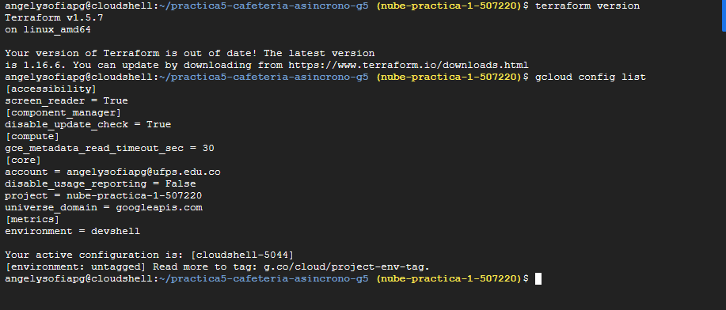

```
angelysofiapg@cloudshell:~/practica5-cafeteria-asincrono-g5 (nube-practica-1-507220)$ gcloud config list
[accessibility]
screen_reader = True
[component_manager]
disable_update_check = True
[compute]
gce_metadata_read_timeout_sec = 30
[core]
account = angelysofiapg@ufps.edu.co
disable_usage_reporting = False
project = nube-practica-1-507220
universe_domain = googleapis.com
[metrics]
environment = devshell

Your active configuration is: [cloudshell-5044]
[environment: untagged] Read more to tag: g.co/cloud/project-env-tag.
```
### Evidencia 1:
Imagenes creadas:
```
angelysofiapg@cloudshell:~/practica5-cafeteria-asincrono-g5/infra (nube-practica-1-507220)$ gcloud artifacts docker images list us-central1-docker.pkg.dev/nube-practica-1-507220/grupo5p5-imagenes
Listing items under project nube-practica-1-507220, location us-central1, repository grupo5p5-imagenes.

IMAGE: us-central1-docker.pkg.dev/nube-practica-1-507220/grupo5p5-imagenes/backend
DIGEST: sha256:057c1aa4038d432f6dfd0108d2b9dc991b39607cdd2a2326275b154dd8f61b81
CREATE_TIME: 2026-11-07T22:55:22
UPDATE_TIME: 2026-11-07T22:55:22
SIZE: 70507436

IMAGE: us-central1-docker.pkg.dev/nube-practica-1-507220/grupo5p5-imagenes/backend
DIGEST: sha256:47822e2c301ebc0ad695be71852ecb99db0cca39f758ac663947e19b5459db2c
CREATE_TIME: 2026-11-07T22:55:22
UPDATE_TIME: 2026-11-07T22:55:22
SIZE: 1664

IMAGE: us-central1-docker.pkg.dev/nube-practica-1-507220/grupo5p5-imagenes/backend
DIGEST: sha256:da45702d4eeda4574f5cec608ec11efb68618d4743c4dc44fa79d23a8917d84e
CREATE_TIME: 2026-11-07T22:55:22
UPDATE_TIME: 2026-11-07T22:55:22
SIZE: None

IMAGE: us-central1-docker.pkg.dev/nube-practica-1-507220/grupo5p5-imagenes/cocina
DIGEST: sha256:5a0afb2188bd8b36ab81e4b24cbd6583a84ed643a7bbdef12b14904a93e9b9c7
CREATE_TIME: 2026-11-07T22:51:48
UPDATE_TIME: 2026-11-07T22:51:48
SIZE: 1658

IMAGE: us-central1-docker.pkg.dev/nube-practica-1-507220/grupo5p5-imagenes/cocina
DIGEST: sha256:5c17d8df4145d67f46cd4f3fbc7d6f1b350c1cd0c3f732f9c1c4b7a2f737b3a3
CREATE_TIME: 2026-11-07T22:51:48
UPDATE_TIME: 2026-11-07T22:51:48
SIZE: 69118238

IMAGE: us-central1-docker.pkg.dev/nube-practica-1-507220/grupo5p5-imagenes/cocina
DIGEST: sha256:b81998cbf4728d22df7cae4715a04cc23b3acfb409d995cfa59ed7c19a86c0b8
CREATE_TIME: 2026-11-07T22:51:48
UPDATE_TIME: 2026-11-07T22:51:48
SIZE: None

IMAGE: us-central1-docker.pkg.dev/nube-practica-1-507220/grupo5p5-imagenes/frontend
DIGEST: sha256:406d88af4c26957484a0a1d038cd71475faafbae351d18dfb9cf641857e3f73c
CREATE_TIME: 2026-11-07T23:03:09
UPDATE_TIME: 2026-11-07T23:03:09
SIZE: 44314420

IMAGE: us-central1-docker.pkg.dev/nube-practica-1-507220/grupo5p5-imagenes/frontend
DIGEST: sha256:706f1a821f4ad8ac0dfed8c2d4390678d1d8df08f7d0e7bddbf9bf0989cff33f
CREATE_TIME: 2026-11-07T23:03:09
UPDATE_TIME: 2026-11-07T23:03:09
SIZE: 1669

IMAGE: us-central1-docker.pkg.dev/nube-practica-1-507220/grupo5p5-imagenes/frontend
DIGEST: sha256:dc668395cfccc92cd9a22199f5c3107f3132489e9798646c03c6858837886a2d
CREATE_TIME: 2026-11-07T23:03:10
UPDATE_TIME: 2026-11-07T23:03:10
SIZE: None
```
Imagen del frontend en celular:
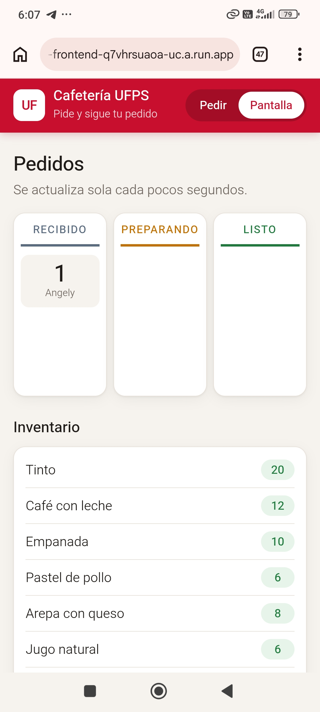

Advertencia del backend: 
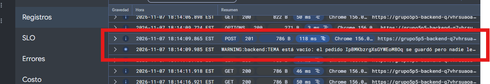

### Evidencia 2: 

Pedido publicado: 
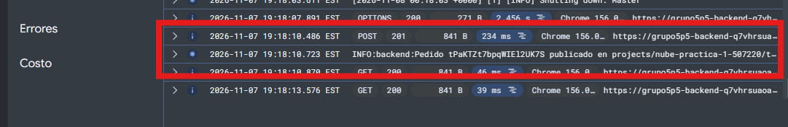

Pedido en recibido: 
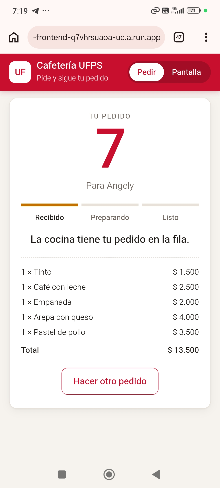

Tema: 
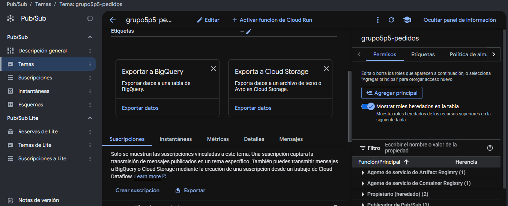


### Evidencia 3: 

Pedido procesado en el teléfono: 
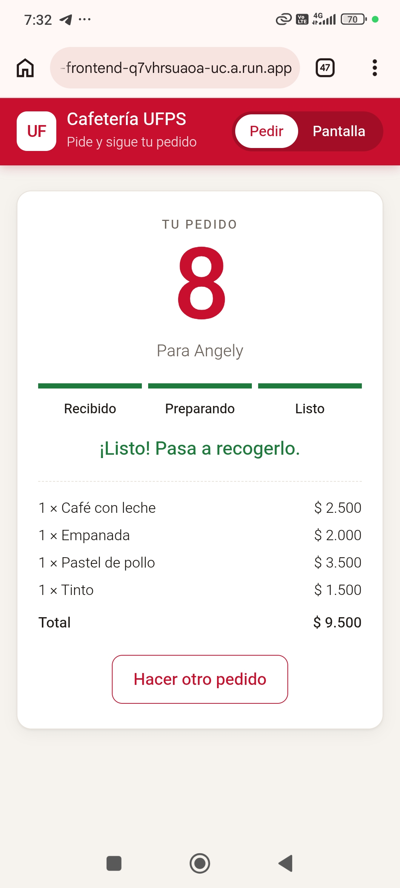

Subscripción: 
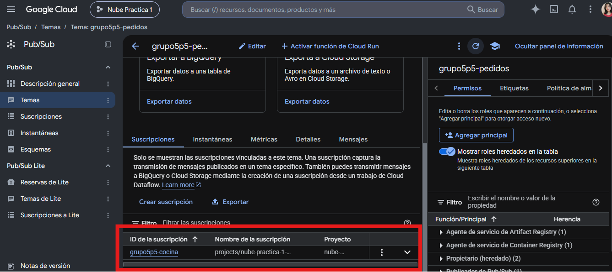

Salida del curl con el 403: 
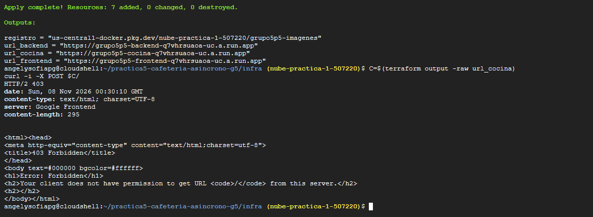

### Evidencia 4:

Salida de la rafaga:
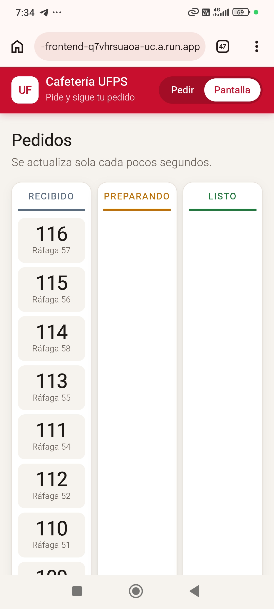

Varias casillas: 
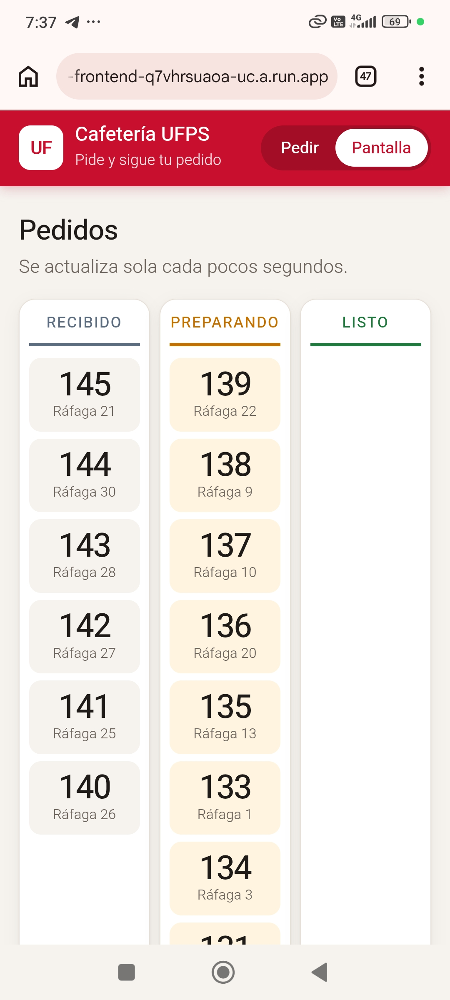

Reponer inventario:
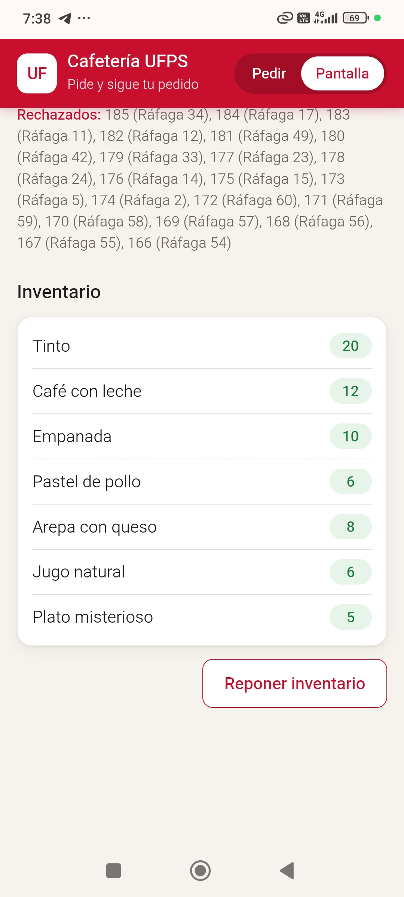

Cantidad de instancias (gráfica):

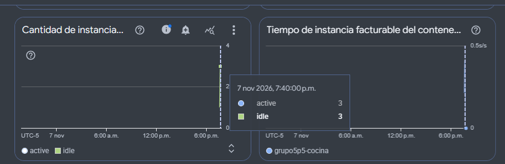

Mensajes:
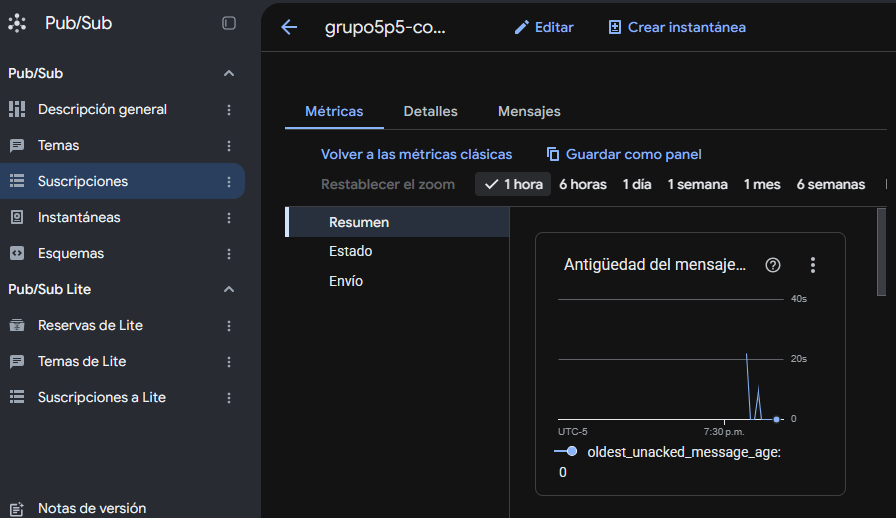

### Evidencia 5: 

Inventario en la pantalla de la cafetería durante la prueba con `PROBABILIDAD_FALLO` en `0.5`:

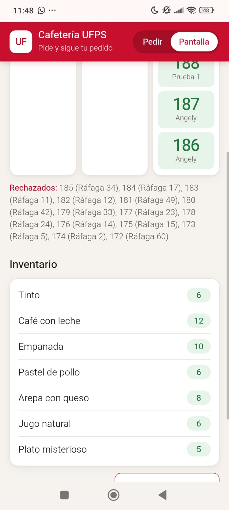

Registro de la cocina con la falla simulada (el trabajo quedó hecho pero no se confirmó, así que Pub/Sub vuelve a entregar el pedido):

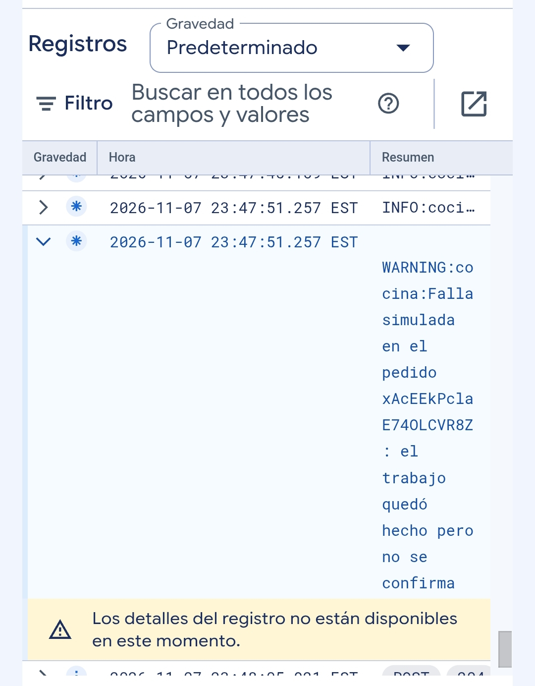

## Decisiones del reto

<!-- Qué cambiaste, por qué y cómo comprobaste que funciona. -->

## Preguntas

<!-- Las respuestas a las preguntas de la guía. -->
